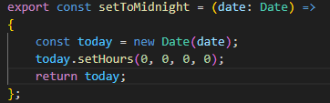
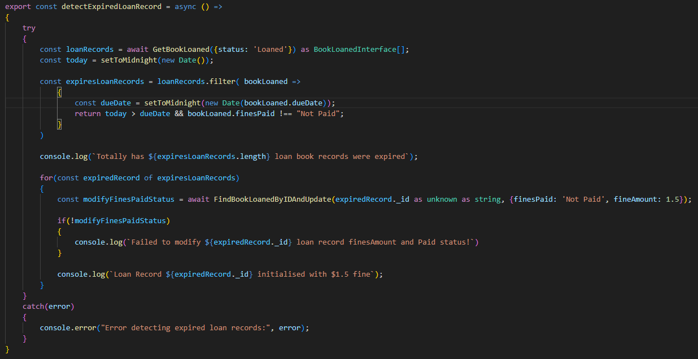
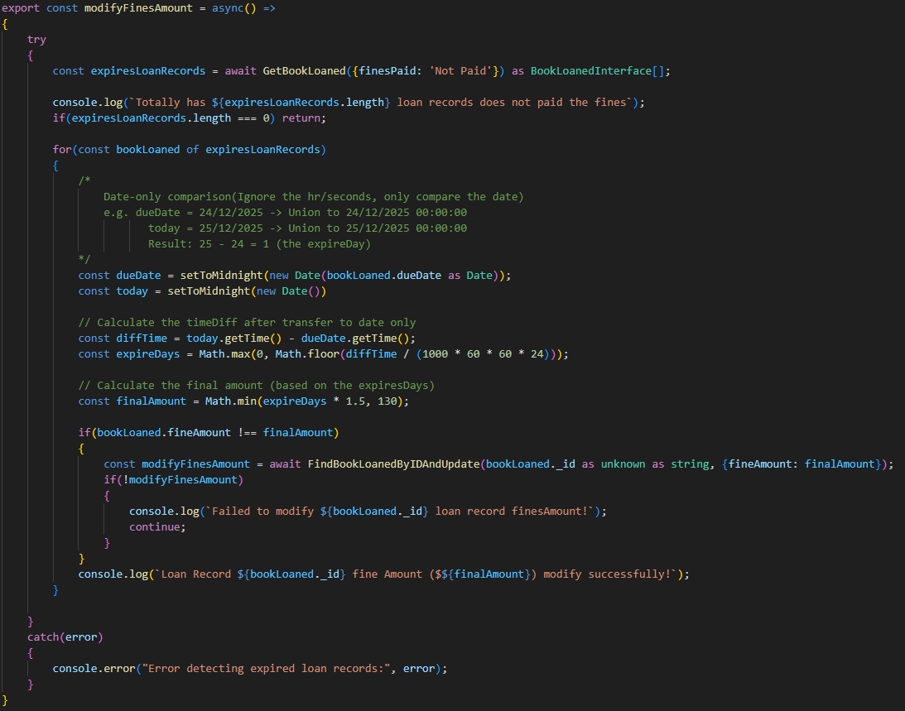
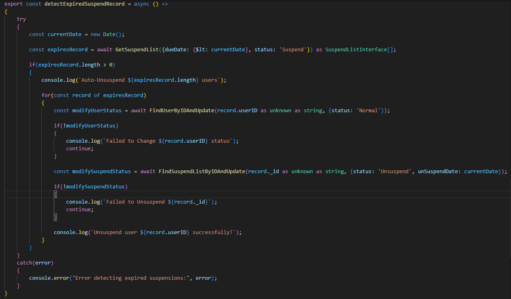

## Automated Logic
- These background services automate recurring business operations that are not visible during live demonstrations

**Remarks**
- The following function is locate in: [detectRecord.ts](../../../backend/src/utils/detectRecord.ts)

### Task Orchestration
- The system uses a centralised orchestration layer to manage all automated background tasks
    - Central task registry
    - Parallel execution via Promise.allSettled
    - Failure isolation and logging
    - Global runtime safeguards

### Triggers / Environments
| Environment      | Trigger         |
| ---------------- | --------------- |
| Local Deployment | UTC+8 Scheduler |
| Railway PaaS     | Boot-up Sync    |
| AWS Serverless   | EventBridge     |

### Business Tasks
- The following automated tasks ensure that penalties, account status updates, and loan record maintenance are processed consistently without manual administrative intervention

1. Set Date Format to Midnight

 

- **Purpose**
    - Standardise date comparisons for overdue detection and fine calculation

- **Implementation**
    - Convert timestamps to 00:00:00
    - Compare using calendar days only

2. Detect Expired Loan Book Records

 

- **Purpose**
    - Identify overdue loans
    - Initialise first-day fines

- **Implementation**
    - Query active loan records
    - Compare dueDate using setToMidnight()
    - Set fineAmount = $1.5

- **Source Code Reference**
    - [bookLoaned.ts](../../../backend/src/schema/book/bookLoaned.ts) (Line 164–202)

3. Scale fines

 

- **Purpose**
    - Apply progressive penalties to overdue loans
    - Prevent unlimited debt accumulation

- **Implementation**
    - Fine increases daily
    - Maximum fine capped at $130
    - Skip unchanged updates to reduce unnecessary database writes

- **Source Code Reference**
    - [bookLoaned.ts](../../../backend/src/schema/book/bookLoaned.ts) (Line 204–256)

4. Auto-Unsuspend

 

- **Purpose**
    - Automatically restore user access when the suspension period expires

- **Implementation**
    - Update User status first
    - Update Suspend record only after success
    - Prevent partial updates and inconsistent account states

- **Source Code Reference**
    - [suspendList.ts](../../../backend/src/schema/user/suspendList.ts) (Line 99–137)

