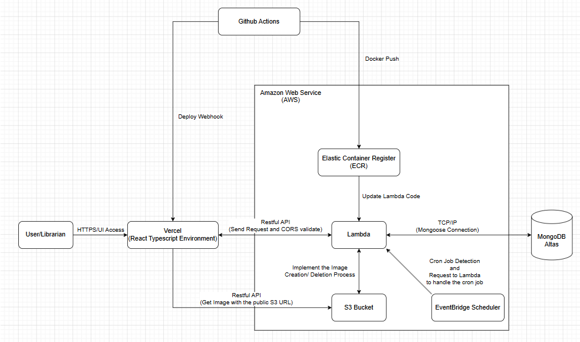
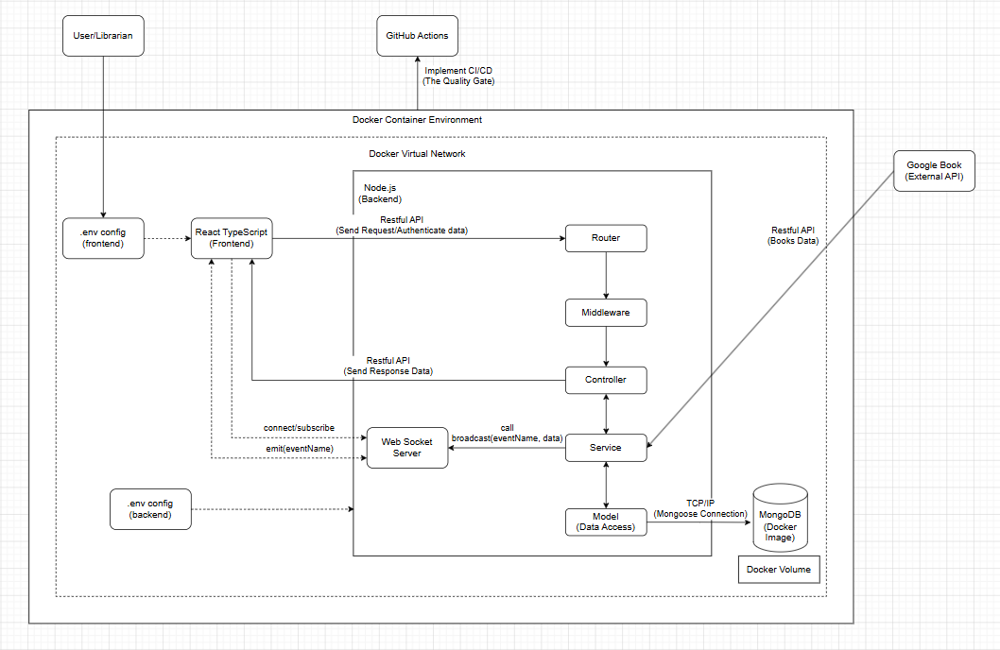

## System Architecture Overview

### Production Architecture
 
Figure 1 - Deployment Architecture Diagram 

- The production stack leverages managed Cloud/SaaS solutions for high availability and performance:
  - Frontend: Vercel
  - Backend: AWS Lambda + ECR
  - Storage: Amazon S3
  - Database: MongoDB Atlas
  - Automation: EventBridge Scheduler

### Development Architecture
 
Figure 2 - Development Architecture Diagram 

**Development Infrastructure**
- Environment Parity
    - Leveraging Docker Compose to mirror the production environment locally 
      (Reducing "works on my machine" inconsistencies via consistent container orchestration)

- Network Isolation
    - All internal services communicate securely within a Docker Virtual Network
    - The database (MongoDB) is isolated from external access, accessible only by the backend service
    
- Persistence & Config
    - Utilises Docker Volumes for persistent data retention
    - Decoupled environment-specific settings via localised .env files for enhanced security
          

### Backend Architecture
 
Figure 3 - Backend Process Flow Diagram 

| Layer            | Responsibility	             |
| ---------------- | ----------------------------|
| Router           | equest Routing              |
| Middleware       | Validation & Authentication |
| Controller       | Request Coordination        |
| Service          | Business Logic              |
| Model (DB)       | Data Persistence            |

- The backend adopts a layered architecture consisting of Router, Middleware, Controller, Service and Model layers

- This structure separates request handling, validation, business logic and data access responsibilities 
  (Which reduce coupling between components and improving maintainability)

- Complex operations such as TF-IDF recommendations, image processing and query generation are delegated to dedicated services 
  (While MongoDB persistence is managed through Mongoose models)

### Architectural Characteristics
- Serverless architecture based on AWS Lambda
- Stateless services with application state externalised to MongoDB Atlas and Amazon S3
- JWT-based authentication and platform-managed secret storage
- Horizontal scalability through managed cloud services

### Key Engineering Decisions & Trade-offs
- **JWT Authentication**
  - Stateless authentication was chosen over server-side sessions to better support serverless deployments and horizontal scaling

- **Serverless Deployment**
  - AWS Lambda was selected over traditional server hosting to minimise infrastructure management overhead while providing cost-efficient scaling

- **Google Books Integration**
  - External book metadata is retrieved through Google Books API to avoid maintaining a large internal catalogue during the MVP stage

- **Layered Backend Architecture**
  - Router, Middleware, Controller, Service and Model layers were adopted to improve separation of concerns and maintainability

- **Pragmatic Hybrid Pattern**
  - Certain straightforward business logic remains within controllers during the MVP stage to prioritise development velocity and reduce unnecessary abstraction