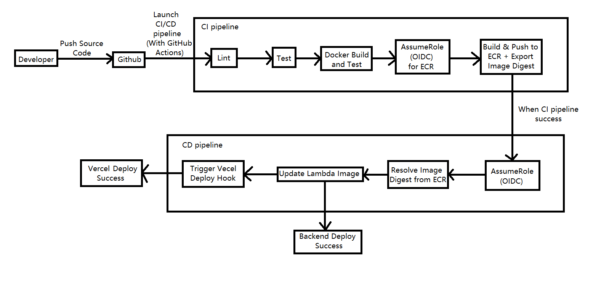

## CI/CD

### Deployment Flow
 
Figure 1 - CI/CD process overview  

- Key design decisions:
    - CI and CD pipelines are separated to ensure deployments occur only after successful validation
    - Docker images are deployed using immutable ECR image digests instead of mutable tags
    - GitHub OIDC AssumeRole is used to eliminate long-lived AWS credentials
    - Frontend deployment is triggered only after backend deployment succeeds

### Continuous Integration (CI) Overview
- GitHub Actions automates linting, testing, container builds and deployment workflows
- Successful builds publish Docker images to Amazon ECR and generate immutable image digests for deployment

### Deployment Strategy
- AWS Lambda deployments are updated using CI-generated image digests rather than mutable tags
- Frontend deployment is triggered through Vercel Deploy Hooks only after backend deployment succeeds
- MongoDB Atlas and Amazon S3 are integrated as managed cloud services for data and asset storage

### Security & Reliability
- GitHub Actions authenticates with AWS using OIDC-based AssumeRole authentication, eliminating long-lived access keys
- CI/CD and Lambda execution responsibilities are separated into dedicated IAM roles following the principle of least privilege

### Design Decisions
- **Immutable Artefact Deployment**
    - CI publishes Docker images to Amazon ECR and exports image digests as deployment artefacts
    - AWS Lambda deployments reference immutable digests rather than mutable latest tags, ensuring reproducible releases and reducing deployment risk

- **OIDC-Based Authentication**
    - Replaced long-lived AWS access keys with GitHub OIDC AssumeRole authentication
    - Eliminated credential storage within CI/CD pipelines while aligning with AWS security best practices

### Remarks
- Documentation-only changes (README, doc/**) are excluded to avoid unnecessary pipeline executions