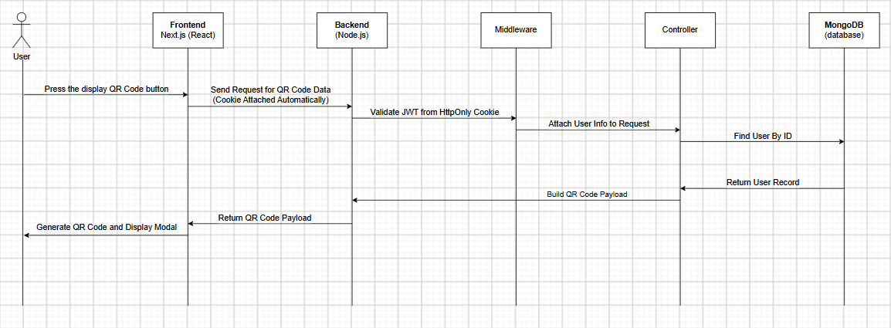

## System Design

### Authentication Flow
 
Figure 1 - User Login Sequence Diagram

- This sequence diagram illustrates the user login workflow, from credential submission and user verification to JWT generation and HttpOnly cookie-based authentication
- The workflow performs request validation, user verification, and JWT-based session establishment through HttpOnly cookies before granting access to protected resources

### External Service Integration Flow
 
Figure 2 - Google Books Integration Sequence Diagram

- This sequence diagram illustrates the external book information retrieval workflow through the Google Books API
- The backend acts as an integration layer that validates requests, consumes external APIs and transforms the response into a consistent format for frontend consumption
    

### Feature Workflow
 
Figure 3 - QR Code Generation Sequence Diagram

- This sequence diagram illustrates the QR code generation workflow for authenticated users
- When the user requests a QR code, the frontend sends a request to the backend with the authentication cookie automatically attached by the browser
- The authentication middleware validates the JWT stored in the HttpOnly cookie and attaches the authenticated user's information to the request context
- The controller retrieves the corresponding user record from MongoDB and constructs a QR code payload 
  (The payload is then returned to the frontend, where the QR code is generated and displayed within a modal dialog)

