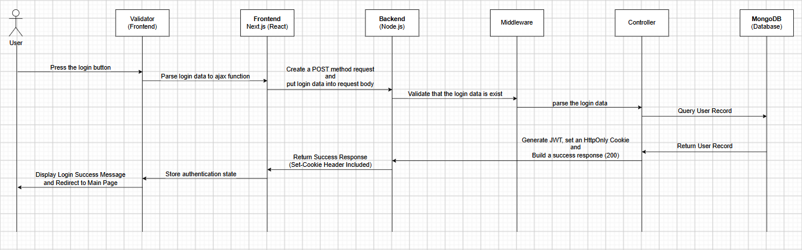
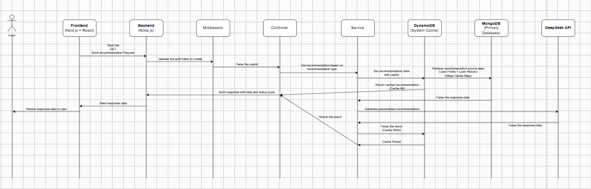

## System Design

### Authentication Flow
 
Figure 1 - User Login Sequence Diagram

- This sequence diagram illustrates the user login workflow, from credential submission and user verification to JWT generation and HttpOnly cookie-based authentication
- The workflow performs request validation, user verification, and JWT-based session establishment through HttpOnly cookies before granting access to protected resources

### External Service Integration Flow
 
Figure 2 - Google Books Integration Sequence Diagram

- This sequence diagram illustrates the external book information retrieval workflow through the Google Books API
- The backend acts as an integration layer that validates requests, consumes external APIs and transforms the response into a consistent format for frontend consumption

### Recommendation Workflow 
 
Figure 3 - Book Recommendation Sequence Diagram

- This sequence diagram illustrates the personalised book recommendation workflow
- When a user requests book recommendations, the frontend sends an authenticated request to the backend
- After the authentication token is validated, the recommendation service first attempts to retrieve recommendation data from DynamoDB

- **If a cache hit occurs**
    - The cached recommendation result is returned immediately, reducing response latency and avoiding unnecessary processing

- **If a cache miss occurs**
    - The service retrieves recommendation source data from MongoDB, including the user's profile and loan history
    - The retrieved data is submitted to the DeepSeek API to generate personalised book recommendations
    - The generated recommendation result is stored in DynamoDB before being returned to the frontend

- This workflow implements the Cache-Aside Pattern:
    - MongoDB acts as the system of record
    - DynamoDB serves as the application-level cache
    - DeepSeek provides recommendation generation capabilities

- **Remarks**
    - Cache invalidation follows an event-driven strategy rather than a TTL-based expiration model
    - Recommendation caches are regenerated only when relevant business events occur
    - This approach reduces unnecessary recomputation while maintaining data consistency and improving response performance

### QR Code data Workflow
 
Figure 4 - QR Code Generation Sequence Diagram

- This sequence diagram illustrates the QR code generation workflow for authenticated users
- When the user requests a QR code, the frontend sends a request to the backend with the authentication cookie automatically attached by the browser
- The authentication middleware validates the JWT stored in the HttpOnly cookie and attaches the authenticated user's information to the request context
- The controller retrieves the corresponding user record from MongoDB and constructs a QR code payload 
  (The payload is then returned to the frontend, where the QR code is generated and displayed within a modal dialog)

