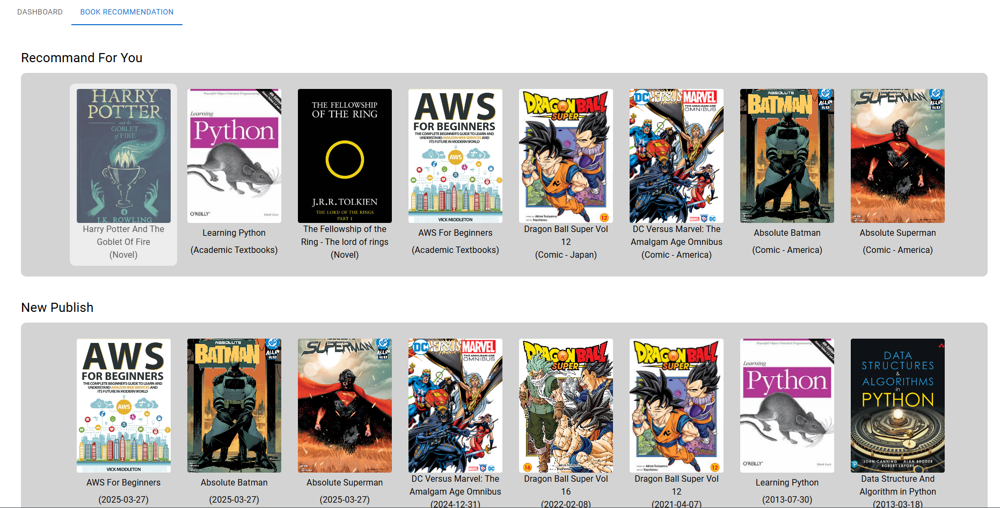
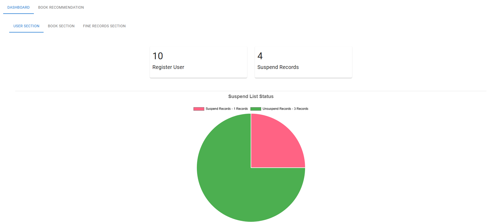
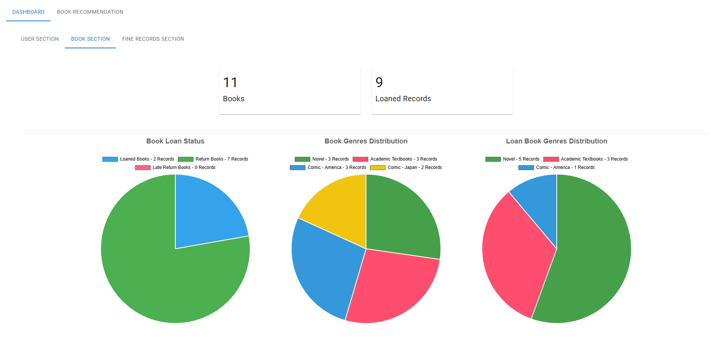
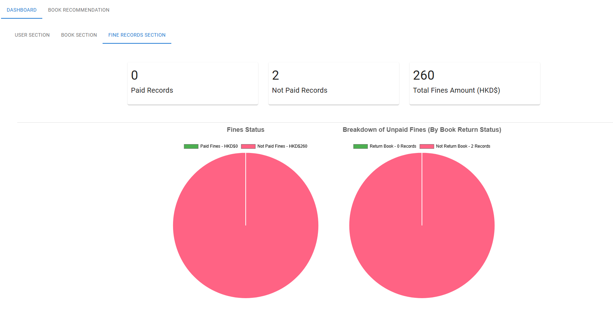
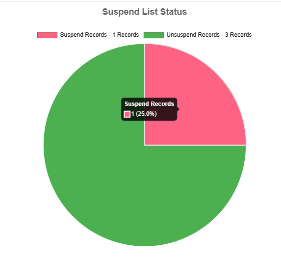

## UI Layout

1. Navigation

 
Image 1.1 - Navigation For Guest User 

 
Image 1.2 - Navigation For Authenticated User 

 
Image 1.3 - Navigation For Admin(Librarian) 

#### Description
- Navigation options vary according to user roles
- Guests can browse book information only
- Authenticated users gain access to personal features such as records, suspension status, profile management, and QR code services
- Librarians are additionally granted administrative functions, including management of books, users, contacts, and system definitions

2. Main page (Book recommendation)

 
Image 2.1 - Main Page For User / Authenticated User (who does not have a loan book record) 

 
Image 2.2 - Main Page For Authenticated User 

#### Description
- Guests and users without loan history are presented with popular and newly added books
- Users with borrowing records receive personalised book recommendations generated by the recommendation system

3. Main Page (For librarian)

 
Image 3.1 - Main Page For Librarian (Admin) 

 
Image 3.2 - User Data Dashboard 

 
Image 3.3 - Book Data Dashboard 

 
Image 3.4 - Loan Book Record Data Dashboard 

 
Image 3.5 - Pie Chart tooltip 

#### Description
- The librarian homepage combines the recommendation module with management dashboards
- Dashboard tabs provide summaries for users, books, and loan/fine records
- Interactive pie charts help librarians quickly identify important trends and exceptions
- Tooltips display category descriptions, values, and percentage distributions

4. Authenticate Pages

 
Image 4.1 - Registration Page 

 
Image 4.2 - Login Page 

#### Description
- Registration and login forms include input validation to ensure data accuracy
- The login page provides an option for persistent or session-based authentication

5. Profile Page

 
Image 5.1 - Profile Page 

 
Image 5.2 - QR Code Modal 

 
Image 5.3 - Edit Profile Data Modal (Username) 

 
Image 5.4 - Edit Profile Data Modal (Password) 

#### Description
- Users can review their account information and access their personal QR code
- Profile information, including username and password, can be updated through dedicated dialog windows
- The QR code is used during the book borrowing process

6. Content Page

 
Image 6.1 - Top of Table Content With Filter (For User) 

 
Image 6.2 - Top of Table Content With Filter (For Librarian) 

#### Description
- Tables support searching, filtering, pagination, and record counting
- Librarians are provided with additional management actions and table-switching controls

7. Modal for view data

 
Image 7.1 - Book data modal (For Guest user) 

 
Image 7.2 - Book data modal (For Authenticated User) 

 
Image 7.3 - Book data modal (Google Book - For Authenticated User) 

#### Description
- Book information dialogs provide different levels of detail based on user permissions.
- Authenticated users can access availability status and extended Google Books information.
- ISBN information can be displayed in barcode format for easier identification.

8. Modal for CRUD operations (Librarian only)

 
Image 8.1 - Book record Creation Modal  

 
Image 8.2 - Book record Create Confirmation Modal  

 
Image 8.3 - Book data Modification Modal  

 
Image 8.4 - Book data Modify Confirmation Modal  

 
Image 8.5 - Book record Delete Confirmation Modal  

#### Description
- Librarians can create, edit, and delete records through guided modal workflows
- Validation is performed before submission
- Confirmation dialogs are used to verify all changes before they are applied

9. Way to display data

 
Image 9.1 - Table Cell with buttons

 
Image 9.2 - Chip set

#### Description
- Data is displayed using structured tables with contextual action buttons
- Chip-based components are used to improve readability and reduce visual clutter

